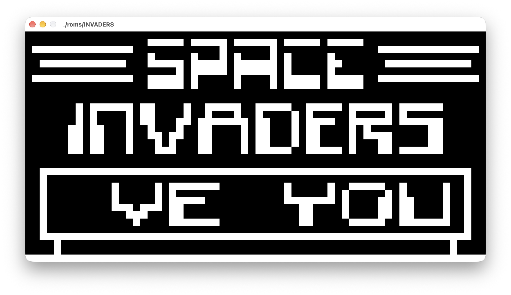
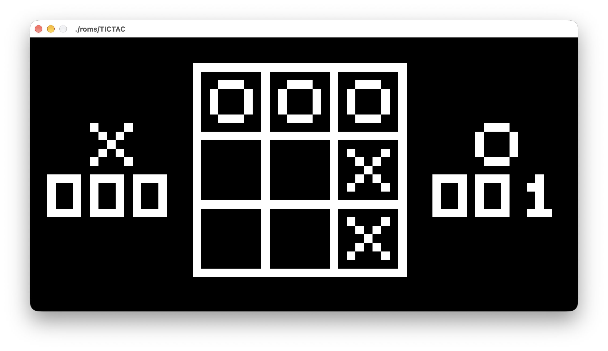

# Chip-8 Emulator

This is a Chip-8 emulator, or more accurately, a Chip-8 interpreter. Chip-8 is a programming language created by Joseph Weisbecker in the 1970s to simplify game development.

I got inspiration for building an emulator from the recent emulation of PlayStation games (including the PS5 itself). Chip-8 is commonly suggested as a starting point for people wanting to learn how to build emulators. 



A lot of inspiration was taken from https://github.com/JamesGriffin/CHIP-8-Emulator. The main difference is that my implementation uses raylib instead of SDL. 

The [design specification](https://www.cs.columbia.edu/~sedwards/classes/2016/4840-spring/designs/Chip8.pdf) I referenced came from Columbia University. 

## Usage

The build step only accounts for macOS/Apple Silicon and assumes you have raylib installed via Homebrew. 

`build.sh` is a small utility script for building the executable:

```bash
chmod +x ./build.sh
make
```

Alternatively:

```bash
mkdir -p build
make
```

Debug with:

```bash
mkdir -p build
make debug
lldb ./chip-dbg ./roms/<game>
```

## Limitations

- Sound is not currently supported, albeit the sound timer itself is implemented.
- There is no way to dynamically set the window dimensions prior to running or change it afterward. They can be manually changed ini `main.cpp`.
- Controls may not be immediately intuitive for every game when running. 

